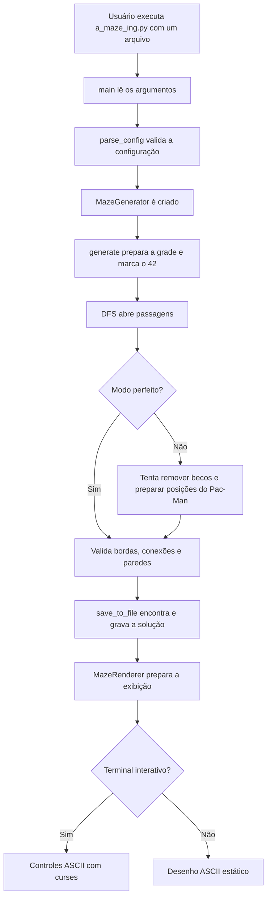

# Guia completo de leitura do projeto A-Maze-ing

Este documento explica a versão final que está nesta pasta `submission_v2`. Ele acompanha o projeto desde a leitura do arquivo de configuração até a geração, validação, gravação e exibição do labirinto. Os nomes de arquivos, classes e métodos abaixo correspondem ao código desta versão.

O objetivo é permitir que alguém leia o código sem precisar adivinhar a ordem das operações ou o significado das estruturas usadas. Primeiro vem o caminho geral; depois, cada módulo, método, algoritmo e decisão é explicado em detalhe.

## 1. O que o programa faz

O programa lê um arquivo de configuração, cria um labirinto retangular, usa DFS para abrir passagens, verifica se o resultado respeita as regras, grava o labirinto em um arquivo e tenta mostrá-lo em uma interface.

Há um algoritmo de geração: DFS, uma busca em profundidade. O projeto usa apenas esse caminho porque o subject exige escolher e explicar um algoritmo; oferecer múltiplos é bônus. O programa também pode inserir o desenho do número 42 no labirinto. Esse desenho é uma região bloqueada: nenhuma passagem pode atravessá-la.

O modo perfeito produz um labirinto conectado sem ciclos. O modo não perfeito parte de um labirinto conectado e tenta abrir passagens extras, criando ciclos e reduzindo becos sem saída, sem abrir uma área livre de 3 por 3.

## 2. Caminho completo de uma execução

O fluxo principal é este:



Em palavras, a ordem é:

1. `a_maze_ing.py` recebe exatamente o caminho do arquivo de configuração.
2. `parse_config()` transforma o texto desse arquivo em valores e rejeita configurações inválidas.
3. `MazeGenerator` confere as dimensões e as coordenadas e prepara o gerador aleatório.
4. `generate()` cria uma grade fechada, calcula a posição do 42 e chama DFS.
5. Se o modo não for perfeito, o programa tenta abrir passagens extras e preparar as posições usadas pelo modo Pac-Man.
6. O gerador verifica a conectividade, a simetria das paredes, as bordas, os ciclos e as regras específicas do modo.
7. `save_to_file()` grava as paredes, a entrada, a saída e uma solução encontrada por busca em largura.
8. `MazeRenderer` usa controles ASCII no terminal interativo ou imprime um desenho estático quando não há teclado disponível.

No terminal, o usuário pode regenerar o labirinto. A cada regeneração, o programa atualiza a grade e grava novamente o arquivo de saída.

## 3. Como executar

Partindo da raiz de `submission_v2`:

```bash
python3 a_maze_ing.py config.txt
```

O programa espera um único argumento: o arquivo de configuração. Os caminhos de saída são relativos ao diretório atual do terminal, não ao diretório onde o arquivo de configuração está. Por isso, a execução acima grava `maze.txt` na raiz de `submission_v2`.

Para gerar um labirinto do modo Pac-Man, abra `config.txt` e altere
`PERFECT=True` para `PERFECT=False`. Depois execute o mesmo comando:

```bash
python3 a_maze_ing.py config.txt
```

O resultado substitui `maze.txt`. Para voltar ao modo perfeito, restaure
`PERFECT=True` e execute o comando novamente.

## 4. Como representar o labirinto

### 4.1 Coordenadas e grade

Uma posição é escrita como `(x, y)`: `x` é a coluna e `y` é a linha. A grade, por outro lado, é acessada como `grid[y][x]`. Essa diferença é importante: a primeira coordenada indica a posição horizontal, enquanto a primeira indexação da lista indica a linha.

Por exemplo, em uma grade de largura 5 e altura 3, a posição `(4, 2)` é a última coluna da última linha e fica em `grid[2][4]`.

### 4.2 Paredes como bits

Cada célula guarda quatro bits. Um bit igual a 1 significa que a parede naquela direção está fechada; um bit igual a 0 significa que existe uma passagem naquela direção.

| Direção | Valor | Máscara hexadecimal | Vizinho |
|---|---:|---:|---|
| Norte | 1 | `0x01` | `(x, y - 1)` |
| Leste | 2 | `0x02` | `(x + 1, y)` |
| Sul | 4 | `0x04` | `(x, y + 1)` |
| Oeste | 8 | `0x08` | `(x - 1, y)` |

Uma célula começa com as quatro paredes fechadas: `ALL_WALLS`, que vale `0x0F`, ou 15 em decimal. Para abrir uma parede, o gerador remove o bit correspondente. A passagem precisa ser aberta dos dois lados: abrir o lado leste de uma célula também abre o lado oeste de sua vizinha.

Por exemplo, se a célula `(2, 1)` abre passagem para leste, a célula `(3, 1)` deve abrir para oeste. A validação de consistência verifica justamente esse par de valores.

As células da borda mantêm fechadas as paredes que apontam para fora da grade. Assim, uma passagem interna não pode sair do retângulo do labirinto.

### 4.3 Tipos básicos

`mazegen/types.py` concentra os tipos e constantes compartilhados:

- `Direction` enumera as quatro direções, com os valores usados na máscara.
- `MazeConfig` descreve o formato do dicionário produzido pelo leitor de configuração.
- `ALL_WALLS` representa as quatro paredes fechadas.
- `DELTA` associa uma direção ao deslocamento `(dx, dy)` necessário para chegar à célula vizinha.
- `OPPOSITE` associa cada direção à direção contrária.
- `DIRECTION_CHARS` associa direções às letras usadas na solução gravada.

Essas definições evitam que cada módulo invente seus próprios números ou convenções para as direções.

## 5. Arquivo de configuração

O arquivo usa pares `CHAVE=valor`, um por linha. Linhas vazias e linhas cujo primeiro caractere não branco é `#` são ignoradas. Espaços ao redor da chave e do valor são removidos. As chaves não diferenciam maiúsculas de minúsculas.

Exemplo de `config.txt`:

```text
WIDTH=20
HEIGHT=15
ENTRY=0,0
EXIT=19,14
OUTPUT_FILE=maze.txt
PERFECT=True
SEED=42
```

As seis primeiras configurações são obrigatórias. `SEED` é opcional e, quando fornecida, deve ser um inteiro.

| Chave | Significado | Verificação principal |
|---|---|---|
| `WIDTH` | Número de colunas | Deve ser um inteiro positivo |
| `HEIGHT` | Número de linhas | Deve ser um inteiro positivo |
| `ENTRY` | Coordenada de entrada, `x,y` | Deve ter duas coordenadas inteiras |
| `EXIT` | Coordenada de saída, `x,y` | Deve ter duas coordenadas inteiras e diferir da entrada |
| `OUTPUT_FILE` | Arquivo de saída | Não pode ficar vazio |
| `PERFECT` | Seleciona as regras de labirinto perfeito | Aceita `TRUE` ou `FALSE`, sem diferenciar caixa |
| `SEED` | Semente para aleatoriedade reproduzível | Se fornecida, deve ser um inteiro |

O leitor valida formato e valores básicos. A validação de limites das coordenadas depende também das dimensões e é feita ao construir `MazeGenerator`. Por exemplo, `ENTRY=20,0` não cabe em uma largura de 20, pois a última coluna é 19.

`parse_config()` também rejeita chaves obrigatórias ausentes, linhas sem `=`, chaves repetidas (inclusive quando uma está em minúsculas e outra em maiúsculas), valores vazios onde não são permitidos e valores que não podem ser convertidos para o tipo esperado.

## 6. Entrada do programa: `a_maze_ing.py`

### `main()`

É o ponto inicial da aplicação. Ele verifica a quantidade de argumentos, lê a configuração, constrói o gerador, gera o labirinto, grava o arquivo e passa os dados ao renderizador.

Se houver erro de configuração ou de geração, a aplicação informa o erro e encerra com código de saída diferente de zero. Isso ajuda tanto uma pessoa executando no terminal quanto outro programa que precise detectar falha.

### `regenerate()`

É uma função interna criada por `main()` e passada ao renderizador. Quando a interface pede um novo labirinto, ela chama novamente `generate()`, salva o novo resultado e fornece ao renderizador os dados atualizados.

O fluxo de execução não fica escondido em uma classe de interface: `main()` conecta explicitamente configuração, geração, gravação e exibição.

## 7. Leitura da configuração: `mazegen/parser.py`

### `parse_config(filename)`

Abre o arquivo com um bloco `with`, percorre suas linhas e constrói um dicionário. O bloco `with` garante que o arquivo seja fechado ao terminar a leitura, inclusive quando uma validação falha.

Para cada linha útil, o método separa a chave do valor no primeiro `=`, normaliza a chave para maiúsculas e verifica duplicatas. Depois converte cada campo para o tipo adequado: dimensões para inteiros, coordenadas para pares de inteiros, `PERFECT` para booleano e semente para inteiro quando presente.

Não há seleção de algoritmo: a aplicação sempre usa DFS.

### `parse_coord(s)`

É uma função interna de `parse_config()`. Ela divide o texto da coordenada pela vírgula, exige dois componentes e converte ambos para inteiros. Assim, `3,7` vira `(3, 7)`.

## 8. Geração e validação: `mazegen/generator.py`

### `MazeGenerator.__init__(...)`

Recebe largura, altura, entrada, saída, modo perfeito e semente. Confere se as dimensões são positivas, se entrada e saída são diferentes e se ambas estão dentro dos limites da grade.

O gerador usa `random.Random(seed)` em vez de alterar o estado aleatório global do Python. Com a mesma configuração e semente, as escolhas aleatórias do gerador podem ser reproduzidas.

O objeto também guarda uma grade inicial em que todas as células têm as quatro paredes fechadas, além do conjunto de células reservadas para o desenho do 42.

### `generate()`

É o coordenador da geração. Em cada chamada, ele começa uma grade nova, calcula as células do desenho 42 e marca essas células como bloqueadas. Se a entrada ou a saída coincidir com uma célula do desenho, a geração é rejeitada.

Em seguida, chama DFS. No modo não perfeito, chama `_braid()` e `_ensure_pacman_layout()` para criar rotas extras e conferir as posições especiais. Por fim, fecha as paredes externas e executa as validações do labirinto completo.

### `_braid()`

Procura células comuns que tenham somente uma passagem aberta: são becos sem saída. Usa `_open_neighbours()` para contar as passagens e guarda as células encontradas em uma lista antes de alterar a grade. Antes de processar cada célula, conta novamente, pois uma abertura anterior pode ter mudado sua situação. Para reunir paredes fechadas que levam a vizinhos válidos, chama `_closed_neighbour_directions()`.

Cada tentativa passa por `_try_open_edge()`, que evita criar uma região aberta de 3 por 3. A operação continua enquanto ainda conseguir mudar o labirinto. Portanto, o método tenta remover becos sem saída, mas pode deixar alguns quando a abertura disponível violaria outra regra.

### `_ensure_pacman_layout()`

Prepara o labirinto não perfeito para as posições usadas pelo modo Pac-Man. Considera os quatro cantos e a região central. Usa `_open_neighbours()` para contar as passagens de cada posição. Se houver paredes demais, obtém opções por `_closed_neighbour_directions()` e tenta abrir uma passagem segura para uma célula vizinha.

O método não substitui a validação: `_validate_pacman_spawn_cells()` verifica depois se os pontos necessários realmente têm saída para um corredor e se não caem sobre o desenho 42.

### `_try_open_edge(x, y, direction)`

Tenta abrir uma passagem entre uma célula e sua vizinha. Primeiro rejeita vizinhos fora da grade e células bloqueadas pelo 42. Guarda as máscaras de parede originais, abre os dois lados e verifica se a mudança criou uma área aberta de 3 por 3.

Se criou, restaura os valores anteriores e informa que a tentativa falhou. Se não criou, mantém a passagem e informa sucesso. Guardar e restaurar as duas máscaras torna a tentativa reversível.

### `_validate_borders()`

Garante que as paredes voltadas para fora permaneçam fechadas: norte na primeira linha, sul na última, oeste na primeira coluna e leste na última.

### `_open_neighbours(cell)`

Lista as células vizinhas às quais `cell` realmente tem passagem. Confere que a vizinha está dentro da grade e que os bits das duas células concordam: a passagem precisa estar aberta dos dois lados.

Esse método é usado pelas verificações que percorrem o labirinto e pelas regras das posições Pac-Man.

### `_closed_neighbour_directions(x, y)`

Retorna as direções das paredes fechadas que levam a células dentro da grade e fora do padrão 42. `_braid()` e `_ensure_pacman_layout()` usam esse método para compartilhar a mesma regra de seleção. O resultado é uma lista porque os chamadores embaralham as opções antes de tentar abri-las.

### `_validate_generated_maze()`

Agrupa as verificações finais. Considera como células caminháveis todas as células que não pertencem ao padrão 42. Verifica conectividade, simetria de paredes e quantidade de ciclos. No modo perfeito, exige zero ciclos. No modo não perfeito, exige pelo menos dois. Também verifica os pontos de início do modo Pac-Man e rejeita áreas abertas de 3 por 3.

### `_validate_connectivity(normal_cells)`

Faz uma busca a partir da entrada e confere se alcança todas as células caminháveis. Também verifica que a saída foi alcançada. Isso impede que uma parte do labirinto fique isolada por paredes ou pelo desenho 42.

### `_validate_wall_consistency()`

Compara cada parede interna com a parede correspondente da célula vizinha. A leste deve corresponder oeste; sul deve corresponder norte. Uma discordância indicaria uma passagem desenhada de um lado e fechada do outro.

### `_count_loops(normal_cells)`

Conta cada passagem apenas uma vez: considera as aberturas para leste e sul. Se `E` é o total de arestas/passagens e `V` é o total de células caminháveis conectadas, retorna `E - V + 1`.

Para um grafo conectado, esse valor é a quantidade de ciclos independentes. Uma árvore de expansão tem `V - 1` arestas e, portanto, zero ciclos.

### `_validate_pacman_spawn_cells()`

Confere que cada canto não está bloqueado pelo 42 e possui ao menos um vizinho conectado. Também procura uma posição central caminhável com acesso a corredor. Para dimensões pares, verifica as posições candidatas mais próximas do centro, porque o centro geométrico pode cair entre quatro células.

### `_contains_open_3x3_area()`

Percorre todas as janelas possíveis de 3 colunas por 3 linhas. Para cada janela, verifica se todas as paredes internas horizontais e verticais foram removidas. Se encontrar uma janela totalmente aberta, retorna verdadeiro.

### `save_to_file(filename)`

Calcula a solução entre entrada e saída por meio de `solve_bfs()` e grava o resultado em linhas:

1. Uma linha por fileira do labirinto; cada célula é representada por um dígito hexadecimal que codifica suas paredes.
2. Uma linha em branco.
3. A coordenada da entrada no formato `x,y`.
4. A coordenada da saída no formato `x,y`.
5. A sequência de direções da solução, separadas por vírgula e espaço.

O arquivo é uma representação compacta: ele guarda a máscara de paredes, não um desenho com caracteres de linha e espaços.

### `get_grid()`

Retorna uma cópia das linhas da grade. Assim, quem consulta a grade não recebe diretamente a lista interna que o gerador pode alterar.

### `get_solution_path()`

Retorna a lista ordenada de coordenadas do caminho entre entrada e saída, incluindo as duas extremidades. Usa a implementação compartilhada em `solver.py`.

### `get_pattern_cells()`

Retorna uma cópia do conjunto de células ocupadas pelo 42, evitando expor o conjunto interno para alteração externa.

## 9. O desenho do número 42: `mazegen/pattern42.py`

### `get_pattern_42()`

Define o desenho em texto, com seis linhas e nove colunas. Os caracteres `#` marcam posições preenchidas; os outros caracteres ficam vazios. A função converte o texto em uma matriz de números: 1 para uma posição preenchida e 0 para uma posição vazia. Ela ainda não calcula coordenadas dentro do labirinto.

### `compute_pattern_cells(width, height)`

Calcula a posição central do desenho dentro do labirinto. Exige uma margem de duas células ao redor do padrão. Quando a grade é pequena demais, informa o problema em `stderr` e devolve um conjunto vazio, em vez de tentar colocar o desenho fora dos limites.

### `stamp_pattern_42(grid, cells)`

Para cada coordenada do padrão, define a máscara da célula como `ALL_WALLS`. Assim, essa célula fica isolada e não pode ser atravessada por DFS.

## 10. Geração por DFS: `mazegen/algorithms.py`

DFS recebe a grade, dimensões, gerador aleatório e células bloqueadas. Ele representa as passagens na máscara compartilhada de quatro paredes.

### DFS: busca em profundidade

`generate_dfs()` implementa a variante iterativa do algoritmo conhecido como *recursive backtracker*. Ele começa pela entrada, mantém uma pilha de células e marca as células visitadas.

Em cada etapa, procura vizinhos ainda não visitados e que não estejam bloqueados pelo 42. Escolhe um ao acaso, abre a passagem entre a célula atual e a escolhida e empilha a nova célula. Quando não há vizinho novo, remove a célula atual da pilha e volta à anterior.

Essa estratégia tende a formar corredores longos e sinuosos. A pilha substitui chamadas recursivas, evitando depender da profundidade máxima de recursão do Python.

Depois do percurso principal, há uma recuperação para conectar áreas caminháveis que tenham permanecido separadas por causa das células bloqueadas. As validações finais ainda exigem que todas as células não bloqueadas estejam conectadas.

O projeto tem um algoritmo de geração, DFS. BFS é usado separadamente para encontrar o menor caminho até a saída; não é um algoritmo de geração.

## 11. Busca de solução: `mazegen/solver.py`

O gerador e o gravador compartilham uma única implementação da busca em largura, evitando manter duas versões diferentes da mesma lógica.

### `solve_bfs_path(grid, width, height, start, end)`

BFS (*Breadth-First Search*, busca em largura) começa na entrada e visita primeiro as células a uma passagem de distância, depois as que estão a duas passagens, e assim por diante. Em uma grade em que cada passagem tem o mesmo custo, o primeiro caminho encontrado até a saída tem o menor número de passos.

O método usa uma fila `deque` e um dicionário de predecessores. Quando alcança a saída, segue os predecessores de volta até a entrada e inverte a lista. O resultado contém coordenadas na ordem do percurso, incluindo início e fim.

O método valida os limites das extremidades e só atravessa uma passagem quando os dois lados da parede indicam abertura. Devolve uma lista vazia se as coordenadas forem inválidas ou não houver caminho.

### `solve_bfs_directions(...)`

Usa o caminho de coordenadas para produzir as direções entre pares consecutivos de células. Por exemplo, se o próximo ponto está uma coluna à direita, a direção é leste.

### `solve_bfs(...)`

Converte a lista de direções para texto separado por vírgula e espaço. É o formato usado na linha de solução do arquivo gravado.

## 12. Exibição: `mazegen/renderer.py`

O projeto usa um único renderizador ASCII para cumprir a exibição visual e os controles pedidos. Com um terminal interativo, `curses` lê as teclas; se a saída for redirecionada ou o terminal não funcionar, o programa imprime uma imagem ASCII estática com a solução.

### `MazeRenderer.__init__(...)`

Guarda a grade, dimensões, entrada, saída, solução, padrão 42 e callback de regeneração. Inicializa a solução como escondida e escolhe a primeira cor de paredes.

### `run()`

Inicia o fluxo do terminal, encaminhando para curses ou para a saída ASCII estática.

### `_run_curses_or_ascii()`

Verifica se a saída padrão é um terminal interativo. Se não for, imprime o desenho ASCII. Caso seja, inicia curses; se curses falhar, informa o erro e também imprime o desenho estático.

### `_curses_main(stdscr)`

Desenha repetidamente o labirinto e espera uma tecla. `R` pede outro labirinto ao callback, `S` mostra ou esconde o menor caminho, `C` troca a cor das paredes e `Q` ou `Esc` encerra. O padrão 42 fica sempre visível.

Antes de desenhar, o método compara o tamanho do terminal com o espaço que o
labirinto precisa. Se faltar espaço, mostra as dimensões necessárias e as
atuais e espera uma tecla para tentar de novo. A função interna
`put(row, column, text, attr=0)` também ignora erros de escrita nas bordas do
terminal.

### `_cell_marker(position, solution)`

Escolhe o texto de cada célula: `E` para entrada, `X` para saída, `4` para o padrão e `*` para uma célula do caminho quando ele está visível.

### `_horizontal_line(row)`

Monta uma linha horizontal de paredes e junções para a borda de uma fileira.

### `_middle_line(row, solution)`

Monta a linha com rótulos das células e paredes verticais.

### `_ascii_lines(show_solution)`

Combina linhas horizontais e centrais para formar o desenho completo, incluindo o caminho apenas quando solicitado.

### `_ascii_fallback()`

Imprime o desenho estático completo com a solução, para que a saída redirecionada ainda mostre um exemplo visual.

## 13. Empacotamento e comandos auxiliares

### `mazegen/__init__.py`

Expõe a interface pública do pacote: `MazeGenerator`, `Direction` e `MazeConfig`. Também define a versão `1.0.0`. Assim, outros módulos podem importar os itens principais pelo pacote sem conhecer todos os arquivos internos.

### `pyproject.toml`

Descreve metadados do pacote, versão, dependências de construção e requisito de Python (`>=3.10`). A configuração de mypy exclui pastas de artefatos de construção e cache.

### `.flake8`

Define configurações do Flake8, incluindo limite de linha de 79 caracteres e diretórios gerados que devem ser ignorados.

### `Makefile`

Oferece comandos curtos para instalar ferramentas, executar, iniciar depuração, limpar arquivos gerados, rodar lint e construir o pacote. O alvo `lint` usa as verificações configuradas pelo projeto; `lint-strict` oferece a variante mais estrita definida no próprio arquivo.

### Arquivos de distribuição

O projeto contém artefatos `.whl` e `.tar.gz` do pacote `mazegen`. Eles são arquivos distribuíveis, não são o código-fonte principal que o leitor deve seguir para entender a aplicação. Para acompanhar a execução, leia `a_maze_ing.py` e os módulos em `mazegen/`.

## 14. Leitura sugerida, do começo ao fim

Para estudar o projeto sem saltar entre arquivos sem contexto, siga esta ordem:

1. Leia `README.md` para conhecer o uso e as opções gerais.
2. Abra `config.txt` e identifique dimensões, entrada, saída, modo e semente.
3. Leia `a_maze_ing.py`, começando por `main()` para acompanhar a ordem da aplicação.
4. Leia `mazegen/parser.py` para entender como o texto vira configuração validada.
5. Leia `mazegen/types.py` para conhecer direções, máscaras e tipos compartilhados.
6. Leia `mazegen/generator.py`, acompanhando `__init__()` e depois `generate()`.
7. Leia `generate_dfs()` em `mazegen/algorithms.py` para acompanhar a abertura das passagens.
8. Leia `mazegen/pattern42.py` para entender como as células bloqueadas são calculadas e marcadas.
9. Volte a `generator.py` e acompanhe as rotinas de modo não perfeito e as validações.
10. Leia `mazegen/solver.py` para acompanhar como a solução é encontrada.
11. Leia `save_to_file()` para relacionar o caminho calculado ao arquivo produzido.
12. Leia `mazegen/renderer.py` por último: ele mostra o resultado que o restante do projeto já gerou.

Essa ordem começa pelo fluxo que a pessoa executa e deixa detalhes internos para depois. Ela também ajuda a separar três responsabilidades: interpretar entrada, construir um labirinto válido e apresentar o resultado.

## 15. Um exemplo narrado

Considere a configuração padrão: grade de 20 colunas por 15 linhas, entrada `(0, 0)`, saída `(19, 14)`, `PERFECT=True` e semente 42.

1. `main()` chama `parse_config("config.txt")`.
2. O parser converte as dimensões em inteiros, as coordenadas em tuplas e os valores de modo e semente em seus tipos correspondentes.
3. `MazeGenerator` confirma que as dimensões são positivas e que os dois pontos cabem na grade.
4. `generate()` cria 300 células com paredes fechadas.
5. O padrão 42 é centralizado e marcado como bloqueado. A entrada e a saída são verificadas para garantir que não caíram sobre ele.
6. `generate_dfs()` parte da entrada, avança para vizinhos ainda não visitados e abre as paredes dos dois lados de cada passagem.
7. Como o modo é perfeito, não são abertas passagens extras pelo processo de *braiding*.
8. A validação confirma que todas as células não bloqueadas podem ser alcançadas, que as paredes combinam, que não há ciclos e que não há região aberta de 3 por 3.
9. `save_to_file()` usa BFS para obter o caminho mais curto e grava as máscaras, as coordenadas e as direções.
10. O renderizador mostra controles ASCII em um terminal interativo ou imprime uma versão estática.

Com a mesma semente e as mesmas opções, as escolhas aleatórias do algoritmo são reproduzíveis no mesmo ambiente e versão do código.

## 16. Vocabulário simples

| Termo | Explicação direta |
|---|---|
| Máscara de bits | Um número em que cada bit guarda o estado de uma parede |
| Célula caminhável | Uma posição que não está reservada pelo desenho 42 |
| Passagem/aresta | Ligação aberta entre duas células vizinhas |
| Grafo | Conjunto de células e das ligações abertas entre elas |
| Conectado | Existe um caminho entre quaisquer duas células do conjunto considerado |
| Árvore de expansão | Liga todas as células sem criar ciclos |
| Ciclo | Um caminho que permite retornar ao ponto de partida por outra rota |
| Beco sem saída | Uma célula com apenas uma passagem para outra célula |
| Semente | Valor inicial que torna as escolhas aleatórias repetíveis |
| BFS | Busca por camadas; encontra caminho com menos passos quando cada passagem tem o mesmo custo |
| DFS | Busca que avança fundo por um caminho e depois retorna para explorar alternativas |

## 17. Resumo das responsabilidades

| Arquivo | Responsabilidade |
|---|---|
| `a_maze_ing.py` | Liga configuração, geração, arquivo de saída e renderização |
| `mazegen/parser.py` | Lê e valida o arquivo de configuração |
| `mazegen/types.py` | Define direções, configuração e máscaras |
| `mazegen/pattern42.py` | Calcula e marca as células do desenho 42 |
| `mazegen/algorithms.py` | Implementa DFS iterativo |
| `mazegen/generator.py` | Coordena geração, regras de modo, validações e gravação |
| `mazegen/solver.py` | Encontra o caminho entre entrada e saída por BFS |
| `mazegen/renderer.py` | Mostra o labirinto em terminal ASCII interativo ou estático |
| `config.txt` | Configuração padrão de execução |
| `pyproject.toml`, `.flake8`, `Makefile` | Metadados e comandos de desenvolvimento |

O caminho completo pode ser lido como: **configuração → interpretação → grade → algoritmo de geração → regras e validações → solução → arquivo → apresentação**. Cada etapa tem um lugar definido no código, e os módulos compartilham a mesma representação de coordenadas e paredes.
