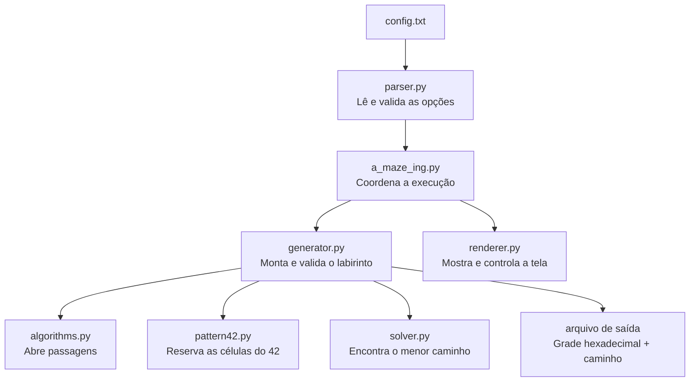

# Mapa visual do código

Este guia mostra por onde os dados passam e onde encontrar cada parte da
lógica. A ideia é poder acompanhar o projeto de cima para baixo antes de ler
os detalhes de cada algoritmo.

## Caminho principal



## Como uma célula guarda as paredes

Cada célula é um número hexadecimal. Os quatro bits indicam quais paredes
estão fechadas:

```text
             Norte: bit 0
                 1
                 │
   Oeste: bit 3 ─┼─ bit 1: Leste
                 │
                 4
             Sul: bit 2
```

Por exemplo, `A` é `1010` em binário. Isso significa que as paredes leste e
oeste estão fechadas. `0` significa que as quatro passagens estão abertas,
sujeito às bordas externas do labirinto.

Quando o gerador abre uma passagem, ele atualiza os dois lados da parede. Por
exemplo, abrir a passagem leste de uma célula também abre a passagem oeste da
célula vizinha.

## Onde ler cada etapa

| Etapa | Arquivo | O que procurar |
|---|---|---|
| Ler configurações | `mazegen/parser.py` | `parse_config()` transforma `KEY=VALUE` em opções tipadas. |
| Organizar a execução | `a_maze_ing.py` | `main()` liga parser, gerador, arquivo e renderer. |
| Criar o labirinto | `mazegen/generator.py` | `generate()` coordena as etapas e a validação. |
| Abrir passagens | `mazegen/algorithms.py` | DFS, Prim e Kruskal usam a mesma representação de paredes. |
| Desenhar o 42 | `mazegen/pattern42.py` | Converte um desenho simples em coordenadas bloqueadas. |
| Encontrar a solução | `mazegen/solver.py` | BFS visita células por distância e reconstrói o menor caminho. |
| Desenhar a tela | `mazegen/renderer.py` | Tkinter, curses e ASCII mostram a mesma grade. |
| Entender bits e direções | `mazegen/types.py` | `Direction`, paredes e coordenadas compartilhadas. |

## Ordem sugerida para estudar o gerador

1. Em `generator.py`, leia `generate()`: ela mostra a sequência inteira.
2. Leia `_reset_grid()`, `_place_pattern_42()` e `_carve_maze()` para ver como
   a grade começa, onde o padrão entra e como o algoritmo é escolhido.
3. Em `algorithms.py`, comece por `generate_dfs()`. A pilha representa o
   caminho atual: avançar quando há vizinho novo e voltar quando não há.
4. Leia `_braid()` para entender como o modo Pac-Man abre passagens extras.
5. Termine em `_validate_generated_maze()`: ela chama verificações menores
   para conectividade, paredes, rotas e áreas abertas.

O renderer é uma camada separada: ele recebe uma grade pronta e não decide
como o labirinto é gerado.
